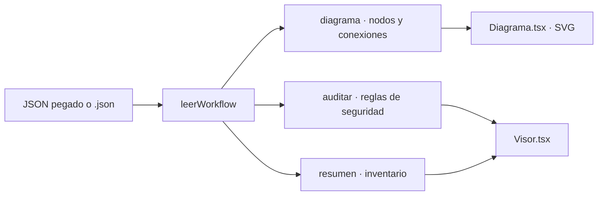

<div align="center">

# 🧩 Visor y auditor de workflows n8n

**Pega el JSON de un workflow de n8n y obtén su diagrama, inventario y una auditoría de seguridad.**

Ideal para revisar workflows antes de importarlos o de entregarlos a un cliente.

[](https://nextjs.org)
[](https://www.typescriptlang.org)
[](https://tailwindcss.com)
[](https://vercel.com)

🌐 **[herramientas.totalsecuritysh.com/n8n](https://herramientas.totalsecuritysh.com/n8n)**

</div>

## ✨ Funcionalidades

| | |
|---|---|
| 🗺️ **Diagrama** | Dibuja los nodos en SVG con sus posiciones reales, colores por categoría, ramas sí/no de los IF y subnodos de IA. Zoom y ajuste a pantalla. |
| 🕵️ **Secretos expuestos** | Detecta API keys de IA, llaves de AWS, tokens de GitHub, Slack, Meta/WhatsApp y Bearer escritos directamente en los nodos. |
| ⚠️ **Riesgos** | Webhooks sin autenticación, peticiones `http://`, nodos que ejecutan comandos, nodos sueltos y falta de workflow de errores. |
| 📦 **Inventario** | Disparadores, servicios conectados y conteo de nodos por categoría. |
| 🎯 **Ir al nodo** | Clic en un hallazgo para resaltar el nodo en el diagrama. |
| 🔒 **Privacidad** | El workflow se analiza en el navegador; las credenciales nunca salen de tu equipo. |

## 🏗️ Arquitectura



```
src/
├── app/                página y layout (basePath /n8n)
├── components/
│   ├── Visor.tsx       entrada, métricas, auditoría e inventario
│   └── Diagrama.tsx    render SVG del workflow
└── lib/
    ├── workflow.ts     lectura, clasificación de nodos y auditoría
    └── ejemplo.ts      workflow de ejemplo (agente de WhatsApp con CRM)
```

- Acepta el workflow copiado desde el editor (Ctrl+A, Ctrl+C), el archivo exportado o la respuesta de la API de n8n.
- Las expresiones de n8n (`={{ ... }}`) no se marcan como secretos: solo los valores fijos.
- Para agregar una regla, añade un patrón a `SECRETOS` o una condición en `auditar()`.

### Multi-zones
Esta herramienta es una **zona** del hub [`tsh-herramientas`](https://github.com/TotalSecurity-SH/tsh-herramientas). Se publica con `basePath: "/n8n"` en su propio proyecto de Vercel y el hub la sirve en `herramientas.totalsecuritysh.com/n8n` mediante *rewrites*. Cada herramienta vive en su propio repo, pero el usuario ve una sola plataforma.

## 🚀 Correr en local

```bash
git clone https://github.com/TotalSecurity-SH/visor-n8n.git
cd visor-n8n
npm install
npm run dev
```

Abre http://localhost:3000/n8n

| Script | Qué hace |
|---|---|
| `npm run dev` | Servidor de desarrollo |
| `npm run build` | Compilación de producción |
| `npm run typecheck` | Genera tipos de rutas y revisa TypeScript |
| `npm run lint` | ESLint |

## ☁️ Desplegar en Vercel

1. Importa el repositorio en [vercel.com/new](https://vercel.com/new).
2. Framework: **Next.js**. No requiere variables de entorno.
3. **Deploy**. Queda en `https://<proyecto>.vercel.app/n8n`.
4. En el proyecto del hub, define `N8N_URL` con esa URL y vuelve a desplegar el hub.

<div align="center">

Hecho por **[Carlos Santiago](https://carlossantiago.totalsecuritysh.com)** · [Total Security SH](https://totalsecuritysh.com) · Full Stack Developer · IA y Automatización

</div>
